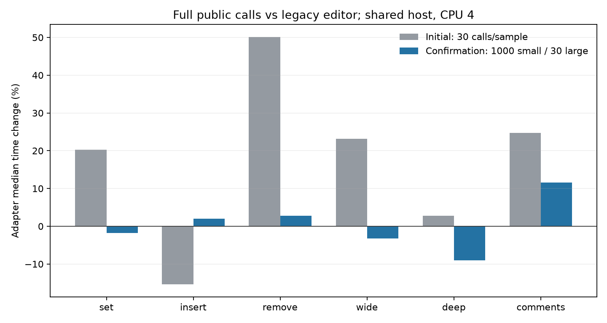

# Canonical adapter paired timings

Complete public calls compared clean legacy `cedb2c3` with the canonical adapter at approved pin `de7dfe092f6d72811417355044e5d024d5600613`. Both binaries were freshly built with the same pinned Goose compiler and `--cc cc -O2`; source/binary/compiler/reproducer hashes stayed unchanged. Both candidates were clean when measured.

Each series has nine shuffled rounds, alternating runner order per case, six fixtures, two runners and 108 checked samples. Process startup and fixture construction are outside the runner clock; parsing, validation, allocation and output replacement remain inside. CPU affinity was 4 on a shared host; there is no exclusive-isolation or universal-throughput claim.

The initial series used 30 calls per sample. Its short-loop medians showed large regressions; the retained confirmation uses 1,000 calls for small cases and 30 for wide/comments. The small-case changes largely disappear with longer loops. The large-case results also vary substantially between series despite unchanged iteration counts, showing host/run sensitivity. The confirmation still records an 11.6% comment-heavy slowdown; this remains a disclosed experimental tradeoff, not a speedup claim.

| Case | Initial change | Confirmed legacy ns/call | Confirmed adapter ns/call | Confirmed change |
| --- | ---: | ---: | ---: | ---: |
| set | +20.3% | 1,683.5 | 1,653.8 | -1.8% |
| insert | -15.4% | 1,945.6 | 1,983.4 | +1.9% |
| remove | +50.2% | 1,177.2 | 1,210.0 | +2.8% |
| wide | +23.2% | 5,089,356.6 | 4,926,945.7 | -3.2% |
| deep | +2.7% | 10,871.5 | 9,892.3 | -9.0% |
| comments | +24.7% | 3,384,279.5 | 3,777,907.5 | +11.6% |



Raw samples and complete provenance: [initial series](initial-30.json), [confirmation](confirmation.json). The exact measurement scripts are recorded by hash and available at each candidate Git revision. Current reproducer: [bench/compare.py](../../compare.py).

Reproduce with an exported legacy checkout and the pinned compiler:

```sh
python3 bench/compare.py --baseline .build/bench-legacy \
  --baseline-source .build/benchmark-baseline-cedb2c3 \
  --baseline-revision cedb2c3c98affbeb45bd34bc7a6618f5a9b75ad0 \
  --candidate .build/bench-adapter --goose "$GOOSE" \
  --rounds 9 --iterations 30 --small-iterations 1000 \
  --output .build/adapter-paired-confirmation.json
```

The first series can be repeated with `--small-iterations 30`. Correctness evidence is separate: exact legacy differential checks, full semantic parsing and sanitizers are recorded in [adapter validation](../../../docs/results/adapter-de7dfe0-validation.json).

Static inspection identifies possible cost centers: canonical result validation creates a fresh parser document; removal builds a node-selection bitmap; lookup walks siblings; source statements retain an extra context field. Legacy code reused its source document for final parsing and used the parser key index. These are structural differences, not measured attribution of the reported percentages. The adapter itself adds no obvious extra result copy relative to legacy ownership handling. No engine or pin changes were made in response to timing.
